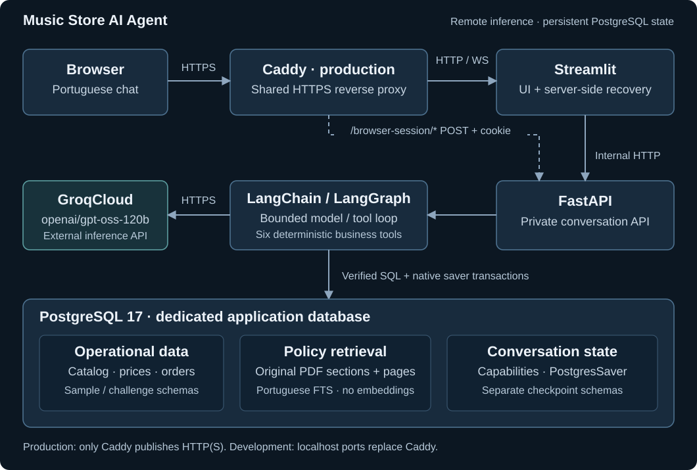

# Music Store AI Agent

A Brazilian Portuguese customer-support assistant for the fictional **Empório da Música**. LangChain and LangGraph coordinate six deterministic tools over PostgreSQL; GroqCloud provides external inference with `openai/gpt-oss-120b`. FastAPI owns the application boundary and Streamlit provides the chat interface.

The public sample mode runs with versioned synthetic fixtures; the optional challenge mode uses the complete synthetic dataset without packaging the source files in the repository. The deployment is designed for a shared, Docker-based VPS behind Caddy. **Application:** [emporio-da-musica.cauafsantos.dev](https://emporio-da-musica.cauafsantos.dev) (production endpoint).

## Key Features

- Source-backed instrument search, specifications, inventory, promotions and exact PIX quotations.
- Order tracking guarded by an exact order number and matching synthetic customer email.
- Portuguese store-policy retrieval with numbered sections and physical PDF page citations.
- PostgreSQL conversation checkpoints, isolated anonymous capabilities and explicit deletion.
- Encrypted HttpOnly browser recovery across refreshes, tab reopening and application restarts.
- Bounded execution, sanitized failures, completed-response SSE and privacy-conscious JSON events.
- Reproducible Docker tests and deterministic evaluations without paid services or live inference.

## System Architecture



In development, the browser reaches Streamlit and the small browser-session API on separate localhost ports. In production, shared Caddy terminates HTTPS and forwards Streamlit HTTP/WebSocket traffic and `/browser-session/*` under one origin. Streamlit calls private FastAPI over Docker networking; browser-side JavaScript never receives the underlying conversation capability.

FastAPI delegates to a durable agent service. `create_agent` constructs the LangGraph model/tool loop with validated arguments and execution middleware. The model selects tools and writes the response; SQL-backed tools determine business facts. Native checkpoints, pending writes and conversation updates share a PostgreSQL transaction. A cross-process conversation lock serializes turns. Failed turns roll back their checkpoints rather than leaving a partially committed conversation.

Operational records, indexed policy sections and checkpoint state have distinct responsibilities. Production reuses shared PostgreSQL, with a dedicated application database and role. GroqCloud is a remote provider: no model weights or GPU inference run on the VPS.

## Technology Stack and Project Structure

| Layer | Technology |
|---|---|
| Runtime and configuration | Python 3.12, uv, Pydantic Settings |
| HTTP and interface | FastAPI, Uvicorn, Streamlit |
| Agent orchestration | LangChain `create_agent`, LangGraph |
| External inference | GroqCloud, `openai/gpt-oss-120b`, `ChatGroq` |
| Data and persistence | PostgreSQL 17, SQLAlchemy, psycopg, PostgresSaver |
| Policy retrieval | pypdf, Portuguese PostgreSQL FTS and GIN indexes |
| Browser credential | Fernet authenticated encryption through cryptography |
| Quality and delivery | pytest, Ruff, Docker Compose, GitHub Actions, GHCR |

Exact Python dependencies are resolved in `uv.lock`; container runtimes are pinned in the Dockerfiles.

```text
src/music_store_agent/
  agent/          # Orchestration, provenance, limits and conversation service
  api/            # Versioned routes, browser bootstrap and sanitized errors
  data/           # Transactional six-CSV ingestion
  database/       # SQLAlchemy models, queries and schema setup
  evaluation/     # Offline cases, runner and separately gated live checks
  policies/       # PDF extraction, indexing and lexical retrieval
  services/       # Availability, exact pricing and order-input rules
  tools/          # Framework-independent public business operations
web/              # Streamlit UI, HTTP client and browser recovery component
tests/            # Real PostgreSQL integration and controlled-inference tests
data/sample/      # Public synthetic CSV and PDF fixtures
docker/           # Development, production and documentation images
docs/             # Local architecture diagram
.github/workflows/ # Offline CI and manually triggered release
```

## Agent Design and Business Tools

| Tool | Responsibility |
|---|---|
| `search_products` | Bounded catalog search by text, category and exact price bounds |
| `get_product_details` | Source specifications with availability and scope flags |
| `get_product_pricing` | Exact quotation, payment context and promotion conflicts |
| `get_active_promotions` | Active source promotions with offer eligibility |
| `get_order_status` | Minimal tracking projection after association verification |
| `search_store_policies` | Bounded original passages with section/page references |

Strict Pydantic schemas reject unknown fields and coercions before tool execution. Catalog and promotion adapters return at most ten results; policy retrieval returns at most three excerpts. Original CSV/PDF contents are not inserted into the system prompt. Tools use real database queries in provenance-verified read-only snapshots.

Availability requires an active source status and positive stock. Explicit accessory/equipment categories are excluded from instrument recommendations; incidental accessory references in instrument descriptions do not change category scope. Discontinued, coming-soon and unknown statuses are not advertised as available.

Prices use `Decimal` and explicit cent rounding. PIX gives 5% off the stored list price only when no active promotion applies. A promotion and PIX never stack. Multiple active promotion records produce a structured conflict rather than an invented best offer. A verified quotation does not imply stock availability.

Order lookup requires both the order ID and its exact associated email, allowing only existing trimming/case normalization. Unknown orders, wrong associations and duplicate customer email identities have the same unverified outcome. Responses contain only order ID, stored status, order date, estimated delivery and tracking code; names, phones, customer IDs, addresses, payment details and internal notes are excluded. This is a demonstration association check, not proof of a person's identity.

## Store Policy Retrieval

The importer extracts the selected PDF, retains its numbered sections and physical page boundaries, and stores the result in PostgreSQL. Portuguese full-text vectors weight headings and content; a small bilingual vocabulary supports common English policy concepts. Ranked passages retain original wording and are bounded before entering model context.

PostgreSQL FTS fits this small, structured policy corpus without an embedding model, vector database, background embedding job or extra service. The trade-off is lexical recall: paraphrases outside the vocabulary can return no evidence. The agent must acknowledge missing evidence rather than invent a rule. This is retrieval-assisted generation using **lexical search**, not embedding/vector search.

## Conversation Persistence and Browser Recovery

Each conversation has a UUID and a random 256-bit bearer capability. PostgreSQL stores its SHA-256 digest, never the raw token. Constant-time authorization occurs before checkpoint access. Native PostgresSaver checkpoints preserve the model/tool messages needed for follow-ups; customer-facing history exposes only user text and final assistant responses.

The browser receives a seven-day, versioned Fernet-encrypted cookie containing its active conversation reference and capability. Production flags are `Secure`, `HttpOnly`, `SameSite=Lax`, `Path=/`, with no Domain attribute. Encryption uses a stable, explicitly configured server secret shared by API and Streamlit. A localhost HTTP exception requires explicit configuration.

A small static Streamlit component performs the real browser POST that receives `Set-Cookie`, then confirms that the browser returns the cookie. It receives only public routing/revision metadata. After reload, the supported read-only Streamlit cookie context makes the opaque credential available server-side; decryption and authorized history retrieval restore the chat from PostgreSQL. Restoration performs no inference and resends no previous message.

“Nova conversa” updates the active reference without deleting old records. Explicit deletion clears recovery after the authorized API deletion returns HTTP 204. Transient recovery errors retain credentials and require an explicit retry. After an ambiguous message timeout, history reconciliation is available; messages are never automatically resubmitted. Cookie removal, expiration or encryption-key replacement ends browser recovery. The UI exposes one active conversation, without an account or conversation browser.

## Data Modes and Provenance

| Mode | Sources | Operational schema | State schema |
|---|---|---|---|
| `sample` (default) | Versioned `data/sample` | `agent_demo` | `agent_state` |
| `challenge` (explicit) | Approved read-only private mount | `agent_demo_challenge` | `agent_state_challenge` |

The complete original synthetic dataset contains 65 products, 9 categories, 25 promotions, 50 customers, 20 orders and 22 order items. Its original PDF indexes into 25 sections across 8 pages. These records differ from the public sample fixtures and are not distributed in GitHub or image layers.

Pinned source SHA-256 checksums and canonical loaded-data fingerprints establish the authorized synthetic baseline. Verification includes indexed policy content and customer identity fields, not just counts. Runtime startup never re-pins a database as trusted. Initialization populates an empty selected schema or verifies an existing matching schema; it refuses populated mismatched data. All six CSVs use the existing atomic importer, including the original `desafio_tecnico_ai_eng - *.csv` filenames.

Sample provenance and legacy capability hashes remain unchanged. Challenge capability digests are domain-bound to its approved baseline, preventing a persisted sample conversation from resuming against challenge data even if a state schema is explicitly reused. Sample input accepts reserved `example.test` emails; challenge message validation accepts only addresses present in the verified synthetic baseline. The order tool still requires the exact order/email association. No free-form customer lookup exists.

## Security, Privacy and Usage Controls

Capabilities are anonymous bearer credentials, not production-grade user authentication. Possession of the encrypted cookie grants access to that demonstration conversation; HttpOnly protection does not turn a stolen cookie into a harmless object. Recovery uses exact configured origins, a custom-header CSRF guard, no wildcard credentialed CORS and no unrestricted redirects. Raw capabilities are not placed in JavaScript, widget values, localStorage, sessionStorage or URLs.

Provider errors are classified and sanitized. Application JSON events contain bounded categories, timings, request correlation and counts, without raw messages, cookies, Authorization headers, keys, tool payloads or provider response bodies. LangSmith tracing is disabled. Treat database backups and native conversation checkpoints as private operational data, since they retain conversation content.

Groq receives user messages, relevant conversation context and bounded tool results. Only authorized synthetic demonstration data should be submitted; local input guards are not a general PII detector or proof of prompt-injection resistance. Source descriptions and PDF text remain untrusted reference data in the model instructions.

Production enables PostgreSQL-backed admission controls: 20 admitted turns per conversation, 100 model attempts per UTC day and one concurrent turn by default. Counters survive application restarts and are shared by replicas using the same checkpoint schema; failures already admitted are charged. A new conversation does not bypass the global daily budget. PostgreSQL advisory locking enforces concurrency across processes. These are application limits, not promises about the provider's free-tier allowance. Local admission is disabled by default; production requires it enabled and initialized. The production configuration is summarized in [Deployment](#deployment).

## Quick Start: Sample Mode

Prerequisites: Git, Docker Engine and Docker Compose v2. No host Python, private challenge files, paid provider tier or local model installation is required.

```sh
git clone https://github.com/cauafsantosdev/music-store-ai-agent.git
cd music-store-ai-agent
cp .env.example .env
chmod 600 .env
docker compose build
```

For real chat, set `GROQ_API_KEY` in the ignored `.env` to an authorized key. Keep `AI_MODEL=openai/gpt-oss-120b` and `AI_DATASET_MODE=sample`. Chat requires network access and provider availability; an empty key still permits offline tests and initialization.

Generate the browser-session key once inside Docker without printing it:

```sh
docker compose run --rm --no-deps -T api uv run --no-sync python - <<'PY'
"""Configure a stable local recovery secret without displaying it."""
import re
from pathlib import Path
from cryptography.fernet import Fernet

path = Path(".env")
text = path.read_text()
if not re.search(r"(?m)^BROWSER_SESSION_KEY=.+$", text):
    text = re.sub(
        r"(?m)^BROWSER_SESSION_KEY=.*$",
        "BROWSER_SESSION_KEY=" + Fernet.generate_key().decode(),
        text,
    )
path.write_text(text)
PY
```

For localhost HTTP, explicitly set `BROWSER_SESSION_ALLOW_HTTP_LOCALHOST=true` in `.env`. Keep both configured origins on `localhost`: UI `http://localhost:8501`, browser API `http://localhost:8000`. If changing ports, update the corresponding origin too. Do not interchange `localhost` and `127.0.0.1` for cookie recovery. HTTPS production keeps the exception disabled.

```sh
docker compose config --quiet
docker compose up -d --build
docker compose exec api uv run --no-sync python -m music_store_agent.agent.cli --init-demo
docker compose exec api uv run --no-sync python -m music_store_agent.agent.cli --init-state
docker compose ps
```

Open [Streamlit on localhost:8501](http://localhost:8501). Development API documentation is available at `http://localhost:8000/docs`. Liveness `/health` does not validate the model. `/ready` checks the selected data, checkpoint initialization and key presence, without a generation request. Successful readiness therefore does not establish live Groq availability.

### Optional complete challenge mode

Place the approved seven originals in ignored `data/private`, or set `CHALLENGE_SOURCE_DIRECTORY` to another private host directory. The explicit override requires that directory and mounts it read-only at `/run/music-store/challenge`:

```sh
docker compose -f compose.yaml -f compose.challenge.yaml run --rm --no-deps api \
  uv run --no-sync python -m music_store_agent.agent.cli --init-demo
docker compose -f compose.yaml -f compose.challenge.yaml run --rm --no-deps api \
  uv run --no-sync python -m music_store_agent.agent.cli --init-state
docker compose -f compose.yaml -f compose.challenge.yaml up -d --build
```

The first command imports all CSVs and indexes the original PDF. The second initializes the independent checkpoint schema. Missing files, changed hashes or mismatched database records fail closed. Existing database volumes and sample schemas are preserved. Running the base Compose configuration again selects sample mode unless explicitly configured otherwise.

## Configuration

Copy the examples and keep live values outside version control. Secrets must not appear in shell tracing, image build arguments or CI artifacts.

| Setting | Meaning / development default |
|---|---|
| `GROQ_API_KEY` | Required only for real provider inference; blank in examples |
| `AI_MODEL` | Supported model: `openai/gpt-oss-120b` |
| `AI_DATASET_MODE` | `sample` by default; explicit `challenge` selection |
| `AI_DEMO_SCHEMA`, `AI_STATE_SCHEMA` | Blank selects mode-specific defaults |
| `CHALLENGE_SOURCE_DIRECTORY` | Host source directory used by the challenge override |
| `BROWSER_SESSION_KEY` | Stable secret shared by API/web; blank example |
| `BROWSER_APP_ORIGIN`, `BROWSER_SESSION_API_ORIGIN` | Exact browser origins; same HTTPS origin in production |
| `BROWSER_SESSION_ALLOW_HTTP_LOCALHOST` | `false`; explicit localhost-only development exception |
| `AI_MAX_MODEL_CALLS`, `AI_MAX_TOOL_CALLS` | Per turn: 4 model calls, 6 tool calls |
| `AI_PROVIDER_TIMEOUT_SECONDS` | 30 seconds per provider request; SDK retries disabled |
| `AI_RECURSION_LIMIT`, `AI_MAX_OUTPUT_TOKENS` | 24 graph steps; 2,048 completion tokens |
| `AI_MAX_HISTORY_MESSAGES` | 60 native messages; bounded-history limit, not summarization |
| `AI_ADMISSION_ENABLED` | `false` locally; required `true` for production |
| `AI_SESSION_REQUEST_LIMIT` | 20 admitted turns per conversation when enabled |
| `AI_DAILY_MODEL_CALL_LIMIT` | 100 model attempts per UTC day when enabled |
| `AI_MAX_CONCURRENT_TURNS` | 1 cross-process active turn when enabled |
| `BACKEND_URL` | Internal Streamlit-to-API URL, normally `http://api:8000` |
| `POSTGRES_*` / production `PG*` | Dedicated database connection; see environment examples |

The [production environment example](.env.prod.example) defines the public domain, private source mount, shared PostgreSQL connection and admission budgets. The immutable `IMAGE_TAG` is maintained separately in `.release.env` by the release workflow.

## API Endpoints

The trusted Streamlit server uses the versioned API. Protected conversation routes require `Authorization: Bearer <capability>`; UUID possession alone is insufficient. Capabilities are returned once on explicit creation, never listed or published in documentation examples.

| Method | Path | Behavior |
|---|---|---|
| GET | `/health` | Process liveness |
| GET | `/ready` | Dependency/data readiness, without inference |
| POST | `/api/v1/conversations` | Create a capability-protected conversation |
| GET | `/api/v1/conversations/{id}` | Authorized filtered history |
| POST | `/api/v1/conversations/{id}/messages` | Complete one bounded turn |
| POST | `/api/v1/conversations/{id}/stream` | Processing, completed message/error, then done SSE events |
| DELETE | `/api/v1/conversations/{id}` | Authorized atomic deletion; HTTP 204 on success |
| POST | `/browser-session/start`, `/check`, `/new`, `/clear` | Browser cookie bootstrap, verification and reference changes |

SSE provides early processing feedback and a **completed-turn response**, not model-token streaming. The response appears only after transactional completion. If a connection is interrupted, the bounded turn can still commit; clients reconcile history instead of retrying ambiguous submissions. Production Caddy exposes the browser bootstrap and Streamlit surface, while keeping `/api/v1/*`, `/docs` and `/openapi.json` private.

## Testing and Evaluation

All Python execution stays in Docker. The normal suite uses real PostgreSQL schemas and controlled model inference; transport guards prevent accidental Groq requests.

```sh
docker compose exec api uv run --no-sync pytest -q
docker compose exec api uv run --no-sync ruff check .
docker compose exec api uv run --no-sync ruff format --check .
docker compose exec api uv lock --check
docker compose exec api uv run --no-sync python -m music_store_agent.evaluation.runner
git diff --check
```

**Latest local validation (November 4, 2026):** **565 passed, 19 skipped** with Ruff lint, formatting and `uv lock --check` passing. The offline evaluation runner reported **13/13 passing categories/scenarios, covering 119 checks**. Seventeen skips are challenge-source-dependent tests in sample mode; the other two are opt-in live Groq tests. These results reflect the reported local Docker run, not a live-provider benchmark.

The offline runner groups catalog, pricing, policies, order privacy, multi-turn memory, safety and reliability checks. Results establish deterministic pipeline behavior with controlled inference, not a 100% LLM reasoning success rate. Tests exercise atomic import, decimal pricing, native saver transactions, failed-turn rollback, cross-process persistence, capability isolation, cookie recovery, frontend behavior, API/SSE boundaries and sanitized diagnostics.

Two provider tests are intentionally opt-in: the minimal-response/function-calling smoke test requires `RUN_LIVE_GROQ=1`; the separate live evaluation requires `RUN_LIVE_GROQ_EVAL=1`. Neither runs in ordinary CI. Enabling either consumes real provider requests and requires an authorized key; the smoke sequence is bounded to three requests and the evaluation to fifteen. No live result is implied by a fake-model test or successful `/ready` response.

The opt-in live evaluator was not executed as part of the ordinary offline suite. Separately captured Groq interactions are identified below.

Challenge-specific tests run only when the approved mount is available; otherwise they report skips. CI remains self-contained with `data/sample`. To include original-source integration cases without changing the running sample stack:

```sh
docker compose -f compose.yaml -f compose.challenge.yaml run --rm --no-deps api \
  uv run --no-sync pytest -q tests/agent/test_datasets.py
```

## Example Conversations and Model Behavior

The following examples distinguish **observed Groq responses** from **illustrative tool-grounded scenarios**. All product and customer references are synthetic; the text distinguishes sample-mode and challenge-mode records. Customer messages are verbatim, while assistant content is labeled as either direct quotation, condensed excerpt, or illustrative response. Prices, stock and policy statements must still be checked against the source tools.

### Example 1 — Live sample-mode catalog and pricing

One actual Groq-assisted turn used the versioned sample dataset and two real tool calls.

> **Customer:** Consulte as ferramentas e indique até dois instrumentos disponíveis no catálogo sintético com preço de até R$ 1.200.
>
> **Assistant (observed result, condensed):** **Sample Acoustic (ID 101)** — preço promocional **R$ 1.104,93**, originalmente **R$ 1.234,56**; disponível para compra. A promoção ativa de 10,5% não é cumulativa com o desconto de PIX.

The pricing tool confirms the values and non-stacking rule. A later follow-up encountered a sanitized Groq rate-limit response; the evaluation does not treat that turn as a successful answer.

### Example 2 — Live challenge-mode conversation: product availability

The following three exchanges came from **one observed multi-turn Streamlit conversation**, using the full synthetic challenge dataset. They demonstrate both grounded catalog retrieval and model-level limitations.

> **Customer:** Quais violões estão disponíveis?
>
> **Assistant (captured excerpt):** Segue a lista dos violões que temos em estoque e que já podem ser comprados:

| ID | Guitar | Price (BRL) | Stock |
|---|---|---:|---:|
| 81 | Yamaha C40 Nylon Natural | 599.90 | 12 |
| 82 | Yamaha C70 Nylon Natural | 849.00 | 8 |
| 83 | Tagima Memphis AC-39 Nylon Natural | 429.90 | 15 |
| 84 | Giannini GN-15 Nylon Cedr Natural | 689.00 | 6 |
| 85 | Rozini RC-104 Nylon Estudante | 459.90 | 10 |

**Source check:** These IDs, names, base prices, active status and stock quantities match the original synthetic product CSV. The observed answer also presented string material, soundboard material and color sourced from product specifications.

### Example 3 — Same live conversation: exchange and return policies

> **Customer:** Quais são as políticas de troca e devolução da loja?
>
> **Assistant (observed result, condensed):** **Política de Trocas e Devoluções — Empório da Música** (*Manual da Loja, seção 4, página 4*). Direito de arrependimento para compras online: **7 dias corridos** após o recebimento. Trocas por defeito: **30 dias corridos** a partir da compra. Trocas por preferência: **7 dias**, observadas as condições da loja.
>
> **Assistant (verbatim, erroneous claim):** O cliente arca com o custo do frete de devolução, salvo se a devolução for por erro da loja (produto errado ou com defeito).

**Source check and limitation:** The original policy PDF supports the cited time windows, but the assistant's freight statement is **incorrect**: section 4.1 explicitly assigns return shipping to **the store** for online withdrawal. The response is retained as observed evidence, not as an authoritative policy quotation. This highlights a factual-grounding limitation despite retrieval and source citations.

### Example 4 — Same live conversation: opening a support request

> **Customer:** Como abrir um chamado e quais documentos enviar?
>
> **Assistant (observed result, condensed):** Sugeriu contato por e-mail, telefone ou formulário online, fornecimento de número do pedido e comprovante de compra, além de fotos do produto quando aplicável. Também afirmou: "A Empório da Música se compromete a responder à sua solicitação em até **2 dias úteis** após o recebimento do chamado completo."

**Source check and limitation:** The original manual documents phone/WhatsApp and email contact, but does **not** establish the suggested online support form or a two-business-day deadline for this procedure. Its separate complaint guidance mentions **24 business hours**. The project exposes informational tools, **not** a ticket-creation tool; therefore, the assistant cannot open a ticket or guarantee that a proposed submission channel exists. The unsupported claims illustrate a limitation to address through stronger source-constrained responses and targeted live evaluations.

### Example 5 — Illustrative privacy-aware tracking flow

This is a **tool-grounded example, not a Groq transcript**. It uses public sample fixtures to demonstrate the privacy boundary.

> **Customer:** Qual é o status do pedido fictício 303 associado ao e-mail wrong@example.test?
>
> **Expected tool-grounded response:** Não foi possível verificar a associação entre o pedido e o e-mail informado.
>
> **Customer:** Corrigindo: o e-mail fictício é customer-203@example.test. Pode consultar o pedido 303?
>
> **Expected tool-grounded response:** O pedido **303** está em processamento; não há código de rastreamento nem previsão de entrega no registro.

The `get_order_status` tests enforce the exact order/email match and do not reveal restricted customer fields when verification fails. This example demonstrates a deterministic authorization rule; it is not evidence of successful live LLM reasoning.

## Engineering Decisions and Trade-offs

| Decision | Benefit and practical trade-off |
|---|---|
| `create_agent` and LangGraph | Official model/tool orchestration and durable native state; framework and provider behavior still require integration tests. |
| Deterministic business tools | Prices, availability and authorization follow auditable code rather than model arithmetic; behavior is deliberately limited to implemented operations. |
| PostgreSQL structured data | Relational constraints, exact decimals, atomic ingestion and existing VPS infrastructure; initialization remains an explicit operational responsibility. |
| PostgreSQL FTS | Keeps a small policy corpus inspectable without embeddings or extra infrastructure; lexical matching has limited semantic recall. |
| PostgresSaver | Durable native messages and transactional recovery across processes; checkpoint storage contains conversation content and needs private backups. |
| Anonymous capabilities | Isolated sessions without account infrastructure; possession is authorization, with no user identity or cross-device recovery service. |
| Separate schemas and pinned provenance | Protect sample reproducibility, dataset boundaries and model-facing synthetic sources; approved source revisions require deliberate pin updates. |
| External Groq GPT-OSS 120B | Function calling without local GPU/model-weight operation or a mandatory paid fallback; privacy, quota, latency and availability depend on the provider. |
| FastAPI plus Streamlit | Separates business/API contracts from a compact Python UI; cookie delivery requires real browser bootstrap rather than server-side HTTP alone. |
| Completed-response SSE | Honest progress feedback without exposing text from a turn that later rolls back; lacks incremental token rendering. |
| Docker-first CI and offline evaluation | Repeatable dependencies and real database behavior without API costs; controlled inference cannot certify live model reasoning. |

## Deployment

The application has a Docker Compose production configuration for a shared VPS: FastAPI and Streamlit run as isolated containers behind the existing Caddy HTTPS reverse proxy, and connect to a dedicated database on shared PostgreSQL. The complete synthetic challenge dataset is mounted read-only; operational files and secrets are not included in the public container images.

**Application:** [Empório da Música — public endpoint](https://emporio-da-musica.cauafsantos.dev)

Releases use the [GitHub Actions production workflow](.github/workflows/release.yml) to publish immutable GHCR images and deploy an approved commit via SSH. Configuration is in [`compose.prod.yaml`](compose.prod.yaml) and [`.env.prod.example`](.env.prod.example). Deployment requires infrastructure-specific credentials and DNS configuration outside the source repository.

## Known Limitations and Future Work

- Groq free-plan capacity and availability are external constraints; there is no quota guarantee, paid fallback or promise of unrestricted public use.
- External inference receives bounded synthetic conversation/tool context; the input guard is not a comprehensive PII classifier.
- Anonymous capabilities are not production-grade user identity. The UI offers one active conversation and no account or multi-conversation browser.
- Encrypted-cookie recovery depends on retained browser storage and a stable secret; key replacement or cookie expiration loses that browser reference.
- Completed-turn SSE is implemented; token streaming is not. Disconnection requires reconciliation instead of automatic resubmission.
- Prompt instructions, bounded tools and tests reduce exposure but do not prove general prompt-injection resistance.
- Lexical policy retrieval can miss unfamiliar paraphrases. Missing evidence is handled explicitly rather than filled with model assumptions.
- The complete challenge dataset remains private-mounted; clones receive only reproducible sample fixtures.
- Admission budgets are shared within a configured checkpoint namespace; separate deployments need a deliberately shared accounting scope to share a provider budget.

Useful future work includes broader independently reviewed live evaluations, stronger operator-controlled abuse protection, retention policies, measured production resource tuning and improved retrieval recall. These are not represented as implemented features.

## AI-Assisted Development and License

Development was directed through explicit requirements, architecture decisions, code reviews and acceptance checks. OpenAI Codex and ChatGPT were used as assistants for parts of the implementation, debugging, test development and documentation. Changes were assessed against the source code, deterministic business rules, reproducible tests and authorized integration checks; assistant output was not treated as independent evidence of correctness. Internal prompts and development conversations are not part of the public documentation.

The source code is distributed under the [MIT license](LICENSE). Original challenge source files are not included in the public source distribution.
